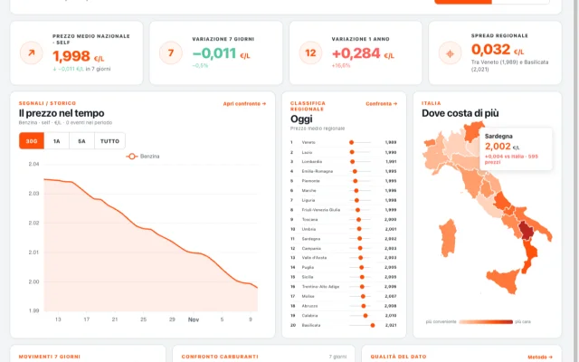

<div align="center">

# Hey, I'm Federico 👋

### Solo developer from Italy building practical AI products, web tools and small Mac apps.

I turn small, annoying problems into focused software — usually with AI somewhere in the loop.

[](https://linkedin.com/in/mdrzn)
[](https://news.ycombinator.com/user?id=mdrzn)

</div>

---

## What I'm building

<table>
<tr>
<td width="50%" valign="top">
<a href="https://prezziallapompa.it"></a>

**[⛽ Prezzi alla Pompa](https://prezziallapompa.it)**<br>
Daily fuel-price averages and trends across Italy, built on official MIMIT data — with a map of every station and side-by-side comparisons.
</td>
<td width="50%" valign="top">
<a href="https://buongiornoai.it"></a>

**[☀️ BuongiornoAI](https://buongiornoai.it)**<br>
Practical AI news and guides for an Italian audience: a free newsletter three times a week, plus short explainer videos.
</td>
</tr>
</table>

## Open source

### Mac apps

<table>
<tr>
<td width="50%" valign="top" align="center">
<a href="https://github.com/mdrzn/menustats"></a>
</td>
<td width="50%" valign="top" align="center">
<a href="https://github.com/mdrzn/cursor-trail"></a>
</td>
</tr>
<tr>
<td valign="top">

**[📊 MenuStats](https://github.com/mdrzn/menustats)**<br>
A menu bar system monitor for people who build things: CPU, memory, sensors, apps, listening ports, AI agent sessions (with Claude Code token usage), per-app volume and keep-awake — in one panel, with themes and ten menu bar looks.

[](https://github.com/mdrzn/menustats/releases/latest)


</td>
<td valign="top">

**[✨ CursorTrail](https://github.com/mdrzn/cursor-trail)**<br>
A lightweight cursor trail for macOS: a fading gradient line or ghost copies of the pointer, with every option of the Windhawk mod it's inspired by, plus an animated rainbow.

[](https://github.com/mdrzn/cursor-trail/releases/latest)


</td>
</tr>
</table>

All three Mac apps install with Homebrew:

```sh
brew tap mdrzn/tap && brew trust mdrzn/tap
brew install --cask --no-quarantine mdrzn/tap/menustats mdrzn/tap/cursortrail mdrzn/tap/screenshot-uploader
```

### Screenshots → remote Claude Code

When Claude Code runs on a server over SSH, it can't see the screenshot on your desktop. These upload it for you and put the remote path on your clipboard:

```
📸 take a screenshot  →  ⬆️ upload over SSH  →  📋 /tmp/screenshots/shot.png  →  paste into Claude Code
```

<table>
<tr>
<td width="50%" valign="top">

**[🍎 claude-screenshot-uploader](https://github.com/mdrzn/claude-screenshot-uploader)**<br>
A native Mac menu bar app: uploads the moment a screenshot is saved, clipboard images with ⌥⌘U, drag and drop, multiple servers with a connection test.

[](https://github.com/mdrzn/claude-screenshot-uploader/stargazers)
[](https://github.com/mdrzn/claude-screenshot-uploader/releases/latest)


</td>
<td width="50%" valign="top">

**[🪟 windows-screenshot-uploader](https://github.com/mdrzn/windows-screenshot-uploader)**<br>
The same workflow on Windows: a system-tray app that picks up screenshots from the clipboard and uploads them.

[](https://github.com/mdrzn/windows-screenshot-uploader/stargazers)


</td>
</tr>
</table>

---

<div align="center">

**Build small. Ship often. Keep it useful.**

</div>
